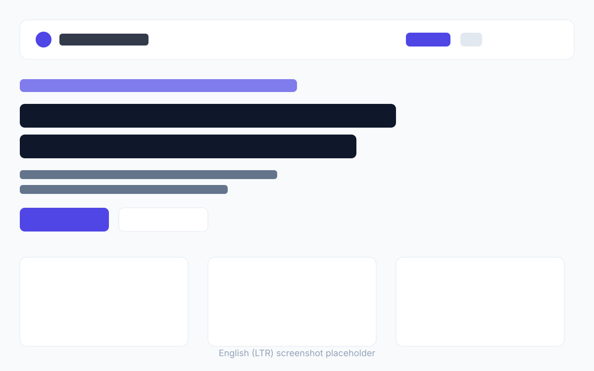
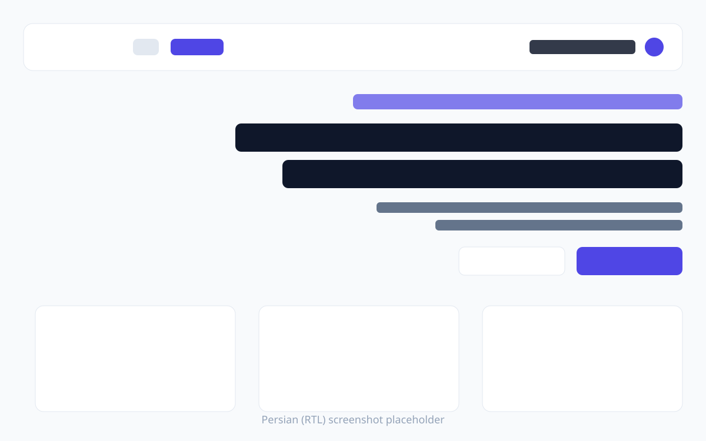

# nuxt-i18n-starter

[](https://github.com/OWNER/REPO/actions/workflows/ci.yml)
[](./LICENSE)
[](https://nuxt.com)
[](https://www.typescriptlang.org/)

A production-ready **Nuxt 3** starter for bilingual **English + Persian (فارسی)** products. Internationalization, RTL layout, dark mode, Pinia, strict TypeScript, linting, pre-commit hooks and CI are already configured — clone it and start writing features instead of infrastructure.

> Replace `OWNER/REPO` in the CI badge with your repository path after publishing.

## Screenshots

| English (LTR)                                  | Persian (RTL)                                  |
| ---------------------------------------------- | ---------------------------------------------- |
|  |  |

The two files in `docs/screenshots/` are placeholders: replace them with real captures once you run the app.

## Use this template

1. Open the repository on GitHub and click **Use this template → Create a new repository**.
2. Clone your new repository.
3. Install dependencies and start the dev server:

   ```bash
   npm install
   npm run dev
   ```

4. Open <http://localhost:3000> for English and <http://localhost:3000/fa> for Persian.

Prefer the command line? `npx nuxi init my-app -t gh:OWNER/REPO` works as well.

## Features

- [x] English and Persian translation catalogues with lazy loading
- [x] URL strategy `prefix_except_default` (English at `/`, Persian at `/fa`)
- [x] Automatic `<html lang>` and `<html dir>` switching on every locale change
- [x] RTL-aware layouts built exclusively with CSS logical properties
- [x] Self-hosted Inter (Latin) and Vazirmatn (Persian) fonts, no external requests
- [x] Light, dark and system theme with no flash of the wrong theme
- [x] Pinia **Setup Stores** with typed state and `localStorage` persistence
- [x] Strict TypeScript, no `any`, generated route and translation types
- [x] ESLint flat config (Nuxt preset + Composition API enforcement) and Prettier
- [x] Husky + lint-staged pre-commit hooks
- [x] GitHub Actions CI: lint, typecheck and build on every push and pull request
- [x] Dependabot for npm and GitHub Actions
- [x] Reusable `BaseButton`, `BaseCard` and `BaseInput` components
- [x] Translated home page, about page and 404 page

## Tech stack

| Layer       | Choice                                               |
| ----------- | ---------------------------------------------------- |
| Framework   | Nuxt 3 (`^3.21`)                                     |
| UI          | Vue 3, `<script setup lang="ts">`, Composition API   |
| State       | Pinia 3 with Setup Stores                            |
| Persistence | `pinia-plugin-persistedstate`                        |
| i18n        | `@nuxtjs/i18n` 9 (`vue-i18n` Composition API)        |
| Theming     | `@nuxtjs/color-mode`                                 |
| Styling     | Tailwind CSS 3.4 with CSS-variable design tokens     |
| Language    | TypeScript 5 (strict)                                |
| Quality     | ESLint 9 flat config, Prettier 3, Husky, lint-staged |
| CI          | GitHub Actions                                       |

## Project structure

```text
nuxt-i18n-starter/
├── app/
│   ├── app.vue                     # Root component, lang/dir head, preference sync
│   ├── assets/
│   │   ├── css/main.css            # Tailwind layers, fonts, theme variables
│   │   └── fonts/                  # Self-hosted Inter + Vazirmatn (woff2)
│   ├── components/
│   │   ├── AppHeader.vue           # Brand, navigation, controls, mobile menu
│   │   ├── AppFooter.vue           # Translated copyright
│   │   ├── LanguageSwitcher.vue    # en ↔ fa switcher
│   │   ├── ThemeToggle.vue         # light → dark → system
│   │   └── ui/
│   │       ├── BaseButton.vue
│   │       ├── BaseCard.vue
│   │       └── BaseInput.vue
│   ├── composables/
│   │   ├── useDirection.ts         # dir / isRtl from the active locale
│   │   └── useTheme.ts             # Typed color-mode helpers
│   ├── layouts/default.vue         # Header + slot + footer
│   ├── pages/
│   │   ├── index.vue               # Home
│   │   ├── about.vue               # About
│   │   └── [...slug].vue           # Translated 404
│   ├── plugins/
│   │   └── pinia-persist.client.ts # Registers persistence plugin
│   └── stores/settings.ts          # Locale + color mode, persisted
├── i18n/
│   ├── i18n.config.ts              # vue-i18n runtime config
│   └── locales/{en,fa}.json        # Translation catalogues
├── docs/screenshots/               # README placeholders
├── .github/
│   ├── workflows/ci.yml
│   └── dependabot.yml
├── .husky/pre-commit
├── eslint.config.mjs
├── nuxt.config.ts
├── tailwind.config.ts
├── tsconfig.json
└── package.json
```

`nuxt.config.ts` sets `srcDir: 'app/'`, so all application code lives in `app/`, while `i18n/`, `public/` and `server/` stay at the project root.

## Getting started

Requirements: **Node.js 20.11.1 or newer** (see `.nvmrc`) and npm.

```bash
npm install     # also runs `nuxt prepare`
npm run dev     # http://localhost:3000
```

| Script                 | Purpose                                     |
| ---------------------- | ------------------------------------------- |
| `npm run dev`          | Start the development server with HMR       |
| `npm run build`        | Build the production server                 |
| `npm run preview`      | Preview the production build locally        |
| `npm run generate`     | Generate a static site (if you go full SSG) |
| `npm run lint`         | Lint with ESLint                            |
| `npm run lint:fix`     | Lint and auto-fix                           |
| `npm run format`       | Format with Prettier                        |
| `npm run format:check` | Check formatting without writing            |
| `npm run typecheck`    | Run `vue-tsc` through `nuxt typecheck`      |
| `npm run postinstall`  | Generate Nuxt types (runs automatically)    |

Husky hooks are installed by `npm run prepare`; they run `lint-staged` on commit, which lints and formats staged files.

## How to add a new language

Arabic is a good example because it is also RTL.

1. **Create the catalogue** `i18n/locales/ar.json` with the same keys as `en.json`.
2. **Register the locale** in `nuxt.config.ts`:

   ```ts
   locales: [
     // ...
     { code: 'ar', name: 'العربية', language: 'ar-SA', dir: 'rtl', file: 'ar.json' },
   ],
   ```

3. **Teach the app that it is RTL**:
   - add `'ar'` to `RTL_LOCALES` in `app/composables/useDirection.ts`;
   - widen `AppLocale` and `SUPPORTED_LOCALES` in `app/stores/settings.ts`;
   - the font switch in `app/assets/css/main.css` uses `html[lang='fa']`; add `html[lang='ar']` there if you want a different typeface.
4. **Expose it in the switcher**: add an option in `app/components/LanguageSwitcher.vue` and a label under `languageSwitcher` in every catalogue.
5. Run `npm run typecheck` — the union types will point at anything you missed.

No route files need to change: `@nuxtjs/i18n` generates the prefixed routes automatically.

## How to customize the theme

All colors are CSS variables in `app/assets/css/main.css`:

```css
:root {
  --color-background: 248 250 252; /* RGB channels, space separated */
  --color-primary: 79 70 229;
  /* ... */
}

.dark {
  --color-background: 2 6 23;
  --color-primary: 129 140 248;
  /* ... */
}
```

Because the values are channel triples, Tailwind opacity modifiers such as `bg-primary/90` keep working. The variables are exposed as Tailwind colors in `tailwind.config.ts` (`background`, `surface`, `foreground`, `muted`, `border`, `primary`, `accent`, `ring`).

To change the brand color, edit `--color-primary` and `--color-ring` in both `:root` and `.dark`. To change typography, update `--font-english` / `--font-persian` and, if you replace the font files, the `@font-face` blocks plus `app/assets/fonts/`.

Theme preference is stored by `@nuxtjs/color-mode` under `nuxt-i18n-starter-color-mode`; the store mirrors it under `nuxt-i18n-starter-settings`. Both keys are configurable.

## Architecture decisions

**Pinia Setup Stores instead of options stores.** Setup stores use the same primitives as components (`ref`, `computed`, `function`), so state, getters and actions are all inferred instead of duplicated through `state`/`getters`/`actions` blocks. There is no `this`, no string-keyed action lookup, and composables can be reused directly inside the store. The `settings` store is persisted with `pick: ['locale', 'colorMode']`, so derived getters like `isRtl` and `currentFont` are never serialized.

**`prefix_except_default` instead of `prefix` or `no_prefix`.** English — the default locale — stays at `/`, which keeps the canonical URLs short for the majority of visitors, while Persian is served at `/fa/...`. Every locale has a distinct, shareable, crawlable URL (`hreflang` friendly), unlike `no_prefix`, and unlike plain `prefix` the default locale is not forced into a redirect. Locale detection is cookie based and only redirects on the root path, so deep links are never hijacked.

**Logical properties instead of left/right.** Classes such as `ms-`, `me-`, `ps-`, `pe-`, `start-`, `end-` and `text-start` map to `margin-inline-start`, `padding-inline-end`, `inset-inline-start` and friends. A single stylesheet then serves both writing directions; there is no `[dir='rtl'] .ml-4 { margin-right: … }` patchwork and no duplicated components. Icons that must mirror use the `.flip-on-rtl` utility.

**Direction derived from the locale, not stored twice.** `useDirection()` computes `dir`/`isRtl` from `useI18n().locale`, and `app.vue` writes the result into `<html lang dir>` through `useHead`. The URL is the single source of truth for language, which keeps SSR output, hydration and the switcher consistent.

**Theme resolved by CSS, preference in a store.** `@nuxtjs/color-mode` applies the `dark` class before paint, so the toggle's sun/moon icons switch with `dark:hidden` / `dark:block` and never flash. The preference (`light`/`dark`/`system`) is mirrored into the settings store for persistence and reuse.

## License

[MIT](./LICENSE)
